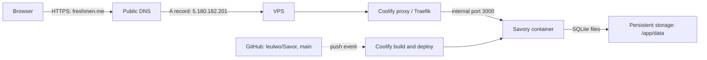

# How Savory is connected to `freshmen.me`

These notes describe the setup we checked on **October 21, 2026**. They contain no passwords, tokens, or environment-file contents. The DNS and website were verified; automatic deploys from GitHub still need a successful webhook test.

## The request path



The domain name tells browsers where to go. Coolify then uses the requested hostname to route traffic to Savory. The container listens on port `3000`; the Coolify proxy handles public HTTP/HTTPS traffic.

## What was already configured in Coolify

The existing application is named **Savory** and is connected to `leulwo/Savor`, branch `main`. It builds from the repository's Dockerfile at the repository root, exposes internal port `3000`, and was reporting `running:healthy` when checked.

Coolify already had these application domains:

- `https://freshmen.me`
- `https://www.freshmen.me`
- A temporary `sslip.io` URL used for testing

Coolify also has persistent storage configured at `/app/data`. The app's default SQLite file is `/app/data/savory.sqlite`, so business data can survive an image rebuild or redeploy. Keep one app replica with this local SQLite setup, and make backups. The app-specific storage, database, and environment instructions are in [DEPLOY_COOLIFY.md](DEPLOY_COOLIFY.md).

## Namecheap DNS change

In Namecheap, open **Domain List → Manage → Advanced DNS → Host Records** for `freshmen.me`.

Before the change, the host-record list had a stale GitHub Pages record:

| Type | Host | Value | Action |
| --- | --- | --- | --- |
| A | `@` | `185.199.108.153` | Deleted |

That IP pointed the root domain away from the VPS. I deleted only that row after you approved it. The three existing `A @ → 5.180.182.201` rows were left untouched. They are duplicate records with the same target; one correct A record is normally enough, but they were preserved as requested.

These existing records/settings were left alone:

- `CNAME leulwe → github.io.`
- Mail SPF TXT value: `v=spf1 include:spf.efwd.registrar-servers.com ~all`

A public DNS lookup after the deletion returned `freshmen.me → 5.180.182.201`; it also returned `www.freshmen.me → freshmen.me`. I opened `https://freshmen.me` in Chrome and confirmed the Savory site loaded.

### What the DNS terms mean

- **A record:** maps a name such as `freshmen.me` to an IPv4 address.
- **`@`:** the root name, `freshmen.me`.
- **CNAME:** makes one name an alias for another name. Here, the public lookup showed `www` aliasing the root domain.
- **TTL:** how long a resolver may keep a DNS answer cached before asking again.

DNS does not contain the website itself. It only directs browsers to the VPS.

## Production configuration to keep aligned

The production app should use the same permanent origin in its runtime configuration:

```dotenv
APP_URL=https://freshmen.me
```

Keep production variables in the Coolify application's environment/build-argument settings, not in Git. Vite's `VITE_FIREBASE_*` values are build-time configuration; payment keys and webhook secrets are server-side secrets. `PRIMARY_ADMIN_EMAIL` must be the Google account email used by the restaurant owner to sign in. Restart the app after changing runtime values. See [DEPLOY_COOLIFY.md](DEPLOY_COOLIFY.md) for the full variable list, Firebase authorized-domain setup, Chapa callback URLs, and data export/import steps.

## GitHub updates and previews

The Coolify app currently points to branch `main`, has **Auto deploy** enabled, and has **Preview deployments** disabled. So `main` is the production branch; pull requests do not get separate preview sites.

One detail matters: this application uses a GitHub **deploy key** (`git@github.com:leulwo/Savor.git`), not a connected GitHub App. Coolify has its GitHub webhook secret configured, but I have not verified a successful push delivery from the repository. A deploy key lets Coolify clone the private repository; it does not send push events to Coolify by itself. For automatic deployments, add the manual GitHub webhook described by [Coolify's automatic deployment guide](https://coolify.io/docs/applications/deployments/automatic-deployments) and [manual webhook guide](https://coolify.io/docs/applications/deployments/manual-webhooks):

1. In Coolify, open Savory's **Webhooks → Manual Git Webhooks** and copy the GitHub payload URL. Keep the webhook secret private.
2. In the GitHub repository, open **Settings → Webhooks → Add webhook**. Use the Coolify URL and the same secret, keep SSL verification enabled, and select push events.
3. In Coolify, confirm **Advanced → Deployment → Auto deploy** is set to **Deploy on push (webhooks)**.
4. Push a small commit to `main`, then confirm a webhook deployment for that commit appears in Coolify's deployment history/logs.

If the repository's **Webhooks** settings are missing, the GitHub account may not have repository-admin access. A repository owner/admin can add the webhook. Until an actual push delivery is confirmed, use Coolify's **Deploy** action when you need to publish a GitHub change.

## Verification checklist

- [x] Coolify app is healthy and configured with the root and `www` domains.
- [x] Stale `@` A record for `185.199.108.153` is removed.
- [x] Public DNS resolves the root domain to the VPS IP.
- [x] `https://freshmen.me` loads the Savory site.
- [ ] Push a commit to `main` and verify Coolify starts a deployment from the GitHub event.

